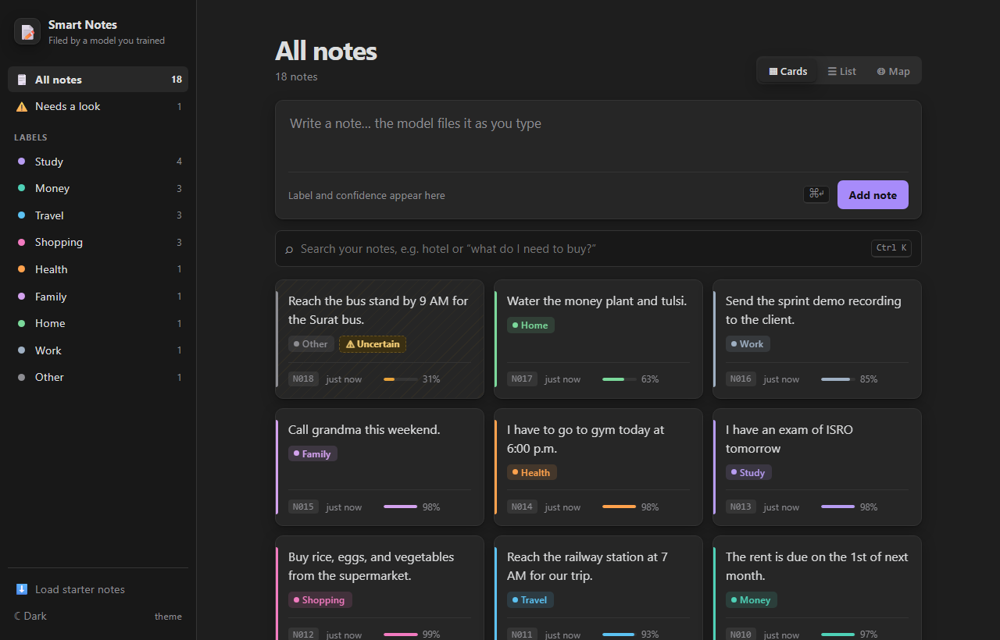
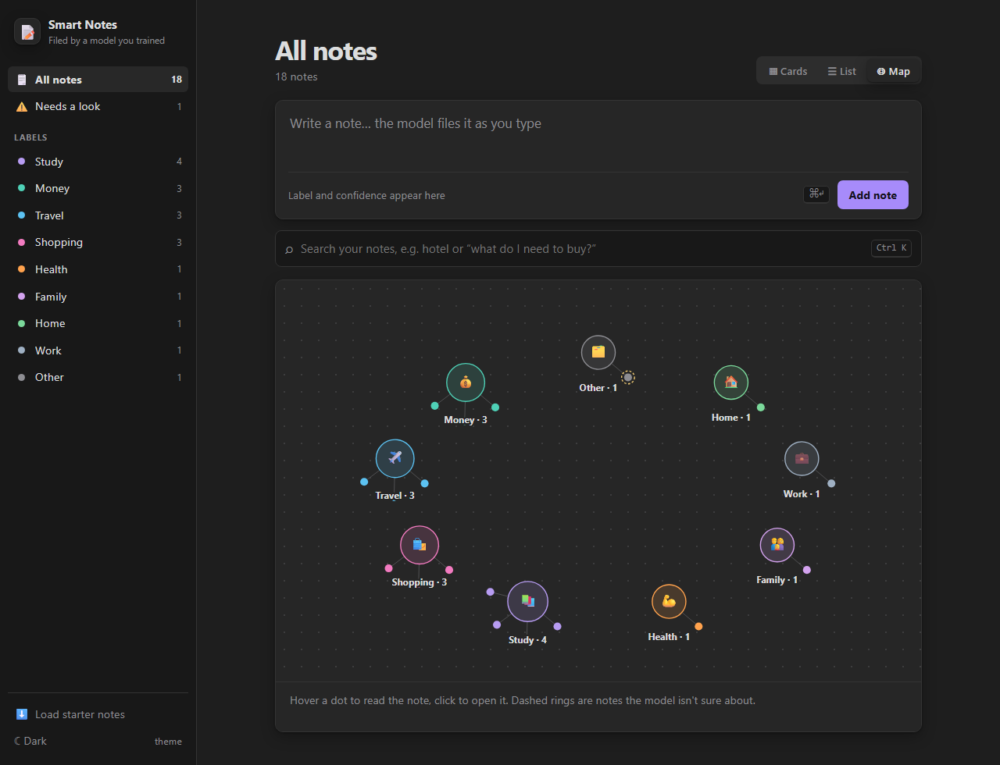
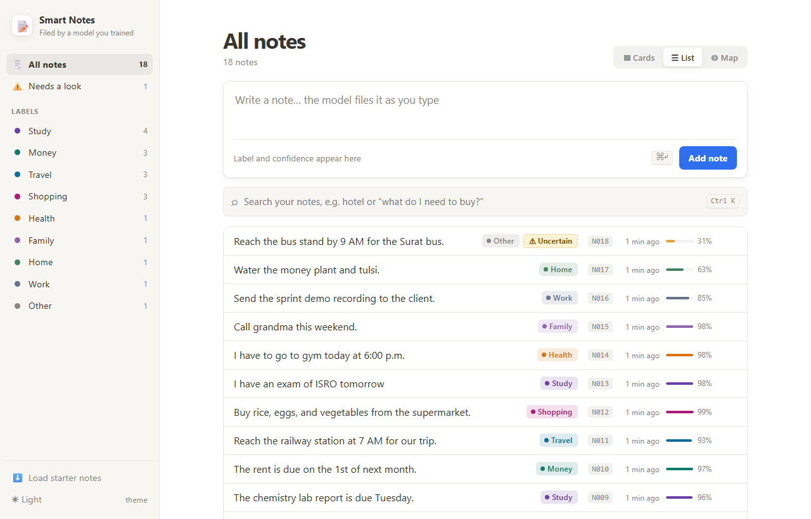

<div align="center">

# 📝 Smart Notes

**Jot a note. A model you trained files it. Search it later, even when you forget the words.**




</div>

> A take-home project for an AI Engineering internship: save notes, classify them with a **model I trained and evaluated myself**, measure how good the **search** is, and make the app **say when it is unsure** instead of forcing a note into the wrong box. No paid API, no GPU, no cloud: everything runs on a laptop CPU.

Full numbers, error analysis and limitations are in **[RESULTS.md](RESULTS.md)**. How AI tools were used is in **[AI_WORKFLOW.md](AI_WORKFLOW.md)**. The original brief is in [docs/assignment/TASK.md](docs/assignment/TASK.md).

## ✨ What it does

| | |
| --- | --- |
| 🏷️ **Files notes for you** | A trained classifier labels every note as you type: **Study, Money, Travel, Shopping**, plus **Health, Family, Home, Work** from a second model. |
| ⚠️ **Knows when it doesn't know** | Notes that fit nothing, or that the model doubts, get an amber **Uncertain** badge instead of a confident wrong label. |
| 🔎 **Searches by meaning** | `money transfer` finds *"Move ₹2,000 into the savings account"* with **no shared words**, using the classifier's sense of topic. |
| 🗺️ **Three views** | Cards, List, and an Obsidian-style **Map** where notes orbit their label. |
| 💾 **Keeps everything** | SQLite storage: IDs, labels and uncertain markers survive restarts. IDs are never reused. |
| 🌗 **Looks good** | Notion-style light theme, Obsidian-style dark theme, keyboard shortcuts, responsive layout. |

<table>
<tr>
<td width="50%"><br><sub><b>Map view</b>: one hub per label, notes orbit it, dashed rings mark uncertain notes.</sub></td>
<td width="50%"><br><sub><b>List view, light theme</b>: label, how long ago, confidence, hover to delete.</sub></td>
</tr>
</table>

## 🚀 Quick start

**You need:** Python 3.12 (tested on 3.12.5). Node.js 18+ is only needed to build the web UI; without it the API and its interactive docs at `/docs` still work. No API keys, GPU or internet are needed at run time.

```bash
# 1. install the pinned Python dependencies
pip install -r requirements.txt

# 2. build the web UI (once)
cd frontend && npm install && npm run build && cd ..

# 3. run the whole app: API and UI in one process
python -m uvicorn smartnotes.api.app:app --host 127.0.0.1 --port 8000
```

Wait for `Application startup complete` (about 7 seconds: scikit-learn import and model load), then open **http://127.0.0.1:8000**. Requests take about 10 to 40 ms once it is up.

> **Port already in use?** Any port works. Pass a different `--port` (for example `8765`) and use it in the URLs below.

The trained models are committed (`models/*.joblib`), so the app starts without training. Notes are stored in `data/notes.db` (created on first run, gitignored). Set `SMARTNOTES_DB=/path/to/other.db` to use another file.

**Try this first:** click **Load starter notes**, then type `I have to go to gym today at 6:00 p.m.` (it files under **Health**), `Call grandma this weekend` (**Family**), and search for `money transfer`.

### Load the sample notes (`N001` to `N012`)
Click **Load starter notes** in the UI, or run the one-liner:

```bash
python -m smartnotes.store.starter
```

They keep their original IDs. Loading twice adds nothing, and notes you add start at `N013` and never reuse an ID, even after deleting.

### Development mode (hot reload)
```bash
python -m uvicorn smartnotes.api.app:app --port 8000     # terminal 1
cd frontend && npm run dev                               # terminal 2 -> http://localhost:5173
# if the API is on another port:  VITE_API_TARGET=http://127.0.0.1:8765 npm run dev
```

## 🖥️ The interface

- **Sidebar** (Notion-style): *All notes*, *Needs a look*, and every label with a colour dot and live count.
- **Capture block**: shows the predicted label and confidence as you type. **Ctrl/⌘ + Enter** saves. An empty note shows an inline message and sends nothing.
- **Search**: **Ctrl/⌘ K** or **/** jumps to it, **Esc** clears it. Each result shows a relevance bar and whether it matched by *keyword*, *topic* or both. Nothing matching well? It says so instead of listing unrelated notes.
- **Views**: **Cards**, **List**, **Map**. On the map, hover a dot to read the note and click to jump to it.
- **Themes**: Auto (follows your system), Light, Dark. The URL hash can preset a view or theme, for example `/#map` or `/#list&dark`.
