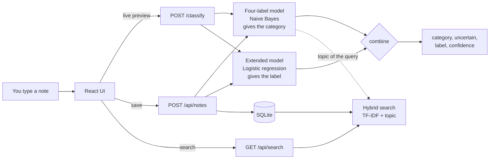

<div align="center">

# 📝 Smart Notes

**Jot a note. A model you trained files it. Search it later, even when you forget the words.**


</div>

> A take-home project for an AI Engineering internship: save notes, classify them with a **model I trained and evaluated myself**, measure how good the **search** is, and make the app **say when it is unsure** instead of forcing a note into the wrong box. No paid API, no GPU, no cloud: everything runs on a laptop CPU.

Full numbers, error analysis and limitations are in **[RESULTS.md](RESULTS.md)**. How AI tools were used is in **[AI_WORKFLOW.md](AI_WORKFLOW.md)**. The original brief is in [docs/assignment/TASK.md](docs/assignment/TASK.md).

## ✨ What it does

| | |
| --- | --- |
| 🏷️ **Files notes for you** | A trained classifier labels every note as you type: **Study, Money, Travel, Shopping**, plus **Health, Family, Home, Work** from a second model. |
| ⚠️ **Knows when it doesn't know** | Notes that fit nothing, or that the model doubts, get an amber **Uncertain** badge instead of a confident wrong label. |
| 🔎 **Searches by meaning** | `money transfer` finds *"Move ₹2,000 into the savings account"* with **no shared words**, using the classifier's sense of topic. |
| 🗺️ **Three views** | Cards, List, and an Obsidian-style **Map** where notes orbit their label. |
| 💾 **Keeps everything** | SQLite storage: IDs, labels and uncertain markers survive restarts. IDs are never reused. |
| 🌗 **Looks good** | Notion-style light theme, Obsidian-style dark theme, keyboard shortcuts, responsive layout. |

<table>
<tr>
<td width="50%"><br><sub><b>Map view</b>: one hub per label, notes orbit it, dashed rings mark uncertain notes.</sub></td>
<td width="50%"><br><sub><b>List view, light theme</b>: label, how long ago, confidence, hover to delete.</sub></td>
</tr>
</table>

## 🚀 Quick start

**You need:** Python 3.12 (tested on 3.12.5). Node.js 18+ is only needed to build the web UI; without it the API and its interactive docs at `/docs` still work. No API keys, GPU or internet are needed at run time.

```bash
# 1. install the pinned Python dependencies
pip install -r requirements.txt

# 2. build the web UI (once)
cd frontend && npm install && npm run build && cd ..

# 3. run the whole app: API and UI in one process
python -m uvicorn smartnotes.api.app:app --host 127.0.0.1 --port 8000
```

Wait for `Application startup complete` (about 7 seconds: scikit-learn import and model load), then open **http://127.0.0.1:8000**. Requests take about 10 to 40 ms once it is up.

> **Port already in use?** Any port works. Pass a different `--port` (for example `8765`) and use it in the URLs below.

The trained models are committed (`models/*.joblib`), so the app starts without training. Notes are stored in `data/notes.db` (created on first run, gitignored). Set `SMARTNOTES_DB=/path/to/other.db` to use another file.

**Try this first:** click **Load starter notes**, then type `I have to go to gym today at 6:00 p.m.` (it files under **Health**), `Call grandma this weekend` (**Family**), and search for `money transfer`.

### Load the sample notes (`N001` to `N012`)
Click **Load starter notes** in the UI, or run the one-liner:

```bash
python -m smartnotes.store.starter
```

They keep their original IDs. Loading twice adds nothing, and notes you add start at `N013` and never reuse an ID, even after deleting.

### Development mode (hot reload)
```bash
python -m uvicorn smartnotes.api.app:app --port 8000     # terminal 1
cd frontend && npm run dev                               # terminal 2 -> http://localhost:5173
# if the API is on another port:  VITE_API_TARGET=http://127.0.0.1:8765 npm run dev
```

## 🖥️ The interface

- **Sidebar** (Notion-style): *All notes*, *Needs a look*, and every label with a colour dot and live count.
- **Capture block**: shows the predicted label and confidence as you type. **Ctrl/⌘ + Enter** saves. An empty note shows an inline message and sends nothing.
- **Search**: **Ctrl/⌘ K** or **/** jumps to it, **Esc** clears it. Each result shows a relevance bar and whether it matched by *keyword*, *topic* or both. Nothing matching well? It says so instead of listing unrelated notes.
- **Views**: **Cards**, **List**, **Map**. On the map, hover a dot to read the note and click to jump to it.
- **Themes**: Auto (follows your system), Light, Dark. The URL hash can preset a view or theme, for example `/#map` or `/#list&dark`.

## 🧠 How it works



- **Two models, one contract.** The brief fixes `POST /classify` to four labels, so the four-label model decides the contract's `category` and nothing about it changes. A second model also knows **Health, Family, Home, Work**: it supplies the `label` the app shows and a second opinion on `uncertain`.
- **Honest uncertainty.** A note is uncertain when the four-label model's top probability is below a learned threshold (0.8971), and the extended model can overrule it: *not* uncertain when it confidently agrees, *uncertain* when it confidently names something outside the four.
- **Search that bridges words.** `score = tf-idf cosine + 0.5 × topic agreement`. The classifier also labels the *query*, so notes in the same topic get a boost even with no shared words. The boost switches off when the classifier is unsure about the query, so unfamiliar queries return nothing instead of unrelated notes.
- **Why not an LLM?** The brief requires a trained classifier driving predictions, and keeping it classical makes the whole project reproducible offline in about a minute.

## 📊 Results at a glance

| | Result | Detail |
| --- | --- | --- |
| **Classifier** (4 labels, validation) | accuracy **0.920**, macro-F1 **0.924** | majority-class baseline 0.300 / 0.115, keyword rules from the category guide 0.560 / 0.529 |
| **Extended labels** (8 labels, held-out final set) | **22 of 27** right (81%) | hand-written notes, written after the training data was frozen and read once |
| **Uncertain flag** | **8%** of validation notes flagged; **11 of 12** notes outside the four categories flagged | on the same held-out final set |
| **Search hit rate @3** | **0.86** hybrid vs **0.57** keyword and TF-IDF | with no shared words: 0.67 vs 0.00. Hit rate @1 is 0.71 vs 0.43 for category-only |
| **API** | all checks of the supplied self-test pass | about 10 to 40 ms per request |

These are small, synthetic datasets, so read them as evidence of a sound method, not as production accuracy. [RESULTS.md](RESULTS.md) has the per-category scores, five misses listed unedited, three distinct validation mistakes with feature-level evidence, and every limitation.

## 🔬 Engineering decisions worth reading

The interesting parts of this project are the bugs I found in my own evaluation:

1. **A baseline that cheated.** My first keyword baseline scored **100%** on validation, because I wrote it after reading the validation set. It is rebuilt from the category guide alone (now 0.56), and the commit says why.
2. **Cross-validation that leaked.** `train.csv` is built from templates, so random folds put near-twins on both sides and looked far too good (CV 0.97 vs 0.88 on validation). That made my first uncertainty threshold flag **54%** of validation notes. Notes that are near-duplicates now stay in the same fold ([`grouping.py`](smartnotes/ml/grouping.py)).
3. **A stop-word list that removed the best Money cue.** scikit-learn's English list drops `bill` (9 notes, all Money), `move` and `due`. A curated function-word list replaced it, guarded by a test ([`text.py`](smartnotes/text.py)).
4. **Data, not a threshold.** The first extended model had 13 to 29% recall on new labels. No threshold fixes that; more varied training notes did.
5. **Contaminated sets are labelled as such.** I wrote a second evaluation set *after* freezing the training data and read it once; `RESULTS.md` says which sets I had already looked at.

## 🔌 The `/classify` API

```bash
curl -X POST http://127.0.0.1:8000/classify \
  -H 'Content-Type: application/json' \
  -d '{"text":"Pay my electricity bill tomorrow."}'
```

```json
{"category":"Money","uncertain":false,"confidence":1.0,"probabilities":{"Money":1.0,"Shopping":0.0,"Study":0.0,"Travel":0.0},"label":"Money","label_confidence":0.9886}
```

- `category` is always one of `Study`, `Money`, `Travel`, `Shopping` (best guess, even when unsure). `uncertain` is a JSON boolean. `confidence` and `probabilities` are extras.
- `label` and `label_confidence` are extras for the app: the label can also be `Health`, `Family`, `Home`, `Work` or `Other`. For *"I have to go to gym today at 6:00 p.m."* the contract still returns one of the four in `category`, with `uncertain: true` because it fits none of them, while `label` is `Health`.
- Invalid input (empty or whitespace text, missing field, non-string, `null`, a list, malformed JSON, more than 1,000 characters) returns **422** with `{"message": "...", "errors": [...]}`, and the server keeps working.
- **Windows PowerShell** strips the inner quotes from `curl -d '{"text":...}'`. Use:
  `Invoke-RestMethod -Method Post -Uri http://127.0.0.1:8000/classify -ContentType application/json -Body '{"text":"Pay my electricity bill tomorrow."}'`

Other routes (interactive docs at `/docs`): `GET/POST /api/notes` (filters `?category=`, `?label=`, `?uncertain=`), `GET/DELETE /api/notes/{id}`, `POST /api/notes/load-starter`, `GET /api/search?q=`, `GET /api/health`.

## 🔁 Reproduce every number

```bash
python train.py                                  # trains both models, prints metrics, mistakes and the uncertainty trade-off (~75 s)
python -m smartnotes.ml.evaluate_labels          # shown-label accuracy and uncertain rates on the held-out sets
python eval_search.py                            # search hit rate @3 for all approaches
python -m smartnotes.ml.experiments              # the "try one fix" comparison
python -m smartnotes.ml.explain "I must reach the railway station by 10 AM." --expected Travel   # why a prediction went wrong

# against a running server:
python examples/test_api.py --url http://127.0.0.1:8000/classify         # the brief's self-test
python examples/replay_validation.py --url http://127.0.0.1:8000/classify # replays validation.csv through the live endpoint
```

`python train.py` reads `data/train.csv`, compares baselines and candidates by template-grouped 5-fold CV on the training data, fits the winner, prints validation metrics, then trains the extended model on `train.csv` + `data/extended_notes.csv`. **Validation labels are never used to fit or choose a model.** Seeds are fixed (`random_state=42`).

## 🧪 Tests

```bash
python -m pytest
```

**93 tests, about 7 seconds, no network or credentials.** They run on a temporary database (never `data/notes.db`) and cover: `/classify` for a normal note and every invalid input, 1,000-character and `₹` text, determinism, and that the `uncertain` flag really follows the model's threshold; saving and reloading notes across a restart; the ID policy and idempotent starter loading; search and its edge cases (including notes with nothing to index); migration of an old database; and a guard that no evaluation note is a training note.

## 🗂️ Project layout

```
smartnotes/
  ml/         preprocessing, baselines, model pipelines, template-grouped CV, uncertainty threshold,
              extended model, explain tool, experiments, train.py, evaluate_labels.py
  text.py     shared function-word stop list
  services/   NoteClassifier: loads both models once, returns category / uncertain / label / confidence
  store/      SQLite note store, never-reused IDs, migration, idempotent starter loader
  search/     keyword, TF-IDF and hybrid retrievers, evaluation harness
  api/        FastAPI app factory, routes (classify, notes, search, health), validation and error shape
frontend/     React + Vite UI (sidebar, capture block, search, cards / list / map)
data/         supplied data, extra labelled notes, two evaluation sets, search query sets
models/       the trained models (committed so the app starts without training)
tests/        pytest suite          examples/   the brief's self-test and a validation replay
docs/         the original brief and README screenshots
```

## ✅ How this maps to the brief

| Part | Requirement | Where |
| --- | --- | --- |
| **A** | Add, save, view, filter, search, persist, load starter notes with their IDs | UI + `store/` + `api/routes/notes.py`; `python -m smartnotes.store.starter` |
| **B** | A trained model, a baseline, one command, validation metrics, error analysis, one fix | `python train.py`; [RESULTS.md](RESULTS.md) |
| **C** | A search test set (14 queries, 6 with no shared words), two or more approaches, hit rate @3 | `data/search_queries.json`, `python eval_search.py` |
| **D** | Say when it is unsure, from the model's own output, with the trade-off reported | [RESULTS.md](RESULTS.md) "Notes that fit no category" |
| **E** | `POST /classify` exactly as specified | [The `/classify` API](#-the-classify-api) |
| **F** | Empty notes handled, tests with one command, docs, AI workflow | `python -m pytest`; [AI_WORKFLOW.md](AI_WORKFLOW.md) |

## ⚠️ Limitations

- The supplied data is synthetic and template-based, so 0.92 validation accuracy means "good on notes that look like the training templates". New phrasing can be confidently wrong: *"I must reach the railway station by 10 AM"* is labelled Study.
- Naive Bayes probabilities are overconfident. The uncertain flag catches notes unlike the training data, not every wrong answer. When both models agree on a wrong core label (for example *"Write a poem about the monsoon"* labelled Study at 0.92) the note is **not** flagged.
- The extra labels rest on 252 notes I wrote and cover only Health, Family, Home and Work. On a 27-note final set 22 got the right label. Unfamiliar words become `Other` or a wrong guess. Adding a label means adding notes for it and running `python train.py`.
- Topic search depends on the classifier: a query it is unsure about gets no topic boost (`where am I staying?` finds nothing), and one it is wrongly sure about can return unrelated notes (`water the plants`).
- The 12 starter notes hold 3 per category, which makes hit rate @3 generous, so RESULTS.md also reports hit rate @1 and MRR.
- The UI was rendered and screenshot-checked but is not covered by automated browser tests; its endpoints are covered by the API tests.
- Single user, single process, no authentication.

## 🔭 What I would do next

- Collect real, varied notes: the supplied data is a few dozen templates.
- Tune the character n-gram range (the cause of the remaining railway-station mistake) and calibrate probabilities (for example `CalibratedClassifierCV`).
- Replace the topic boost with sentence embeddings if a heavier install is acceptable, and test search on a set with more than 3 notes per category.
- Add browser tests for the UI interactions.
